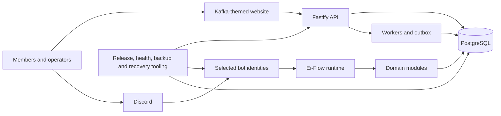

<div align="center">


# EI POINT

### A modular Discord community, moderation, commerce, and operations platform

**One PostgreSQL-backed platform. Six distinct Discord identities. A single, auditable release path.**

[Architecture](#architecture) · [Quick start](#quick-start) · [Development](#development) · [Operations](#operations) · [Readiness](#readiness)

</div>

> [!IMPORTANT]
> **Ei Point is under active development.** The monorepo contains substantial implementations and passing local checks, but production readiness is **not certified**. Legacy feature parity, full-fleet runtime adoption, Linux/VPS builds, live Discord/provider flows, and real recovery/soak acceptance still have open gates. See [Readiness](#readiness) and the [phase gates](docs/phase-gates.md).

## What is Ei Point?

Ei Point is a TypeScript and Python monorepo for operating a coordinated fleet of Discord bots and a Kafka-themed public website/dashboard. Feature logic lives in reusable modules; gateway processes, the API, background workers, PostgreSQL, and operations tooling are separate components. PostgreSQL owns durable business state, while immutable release manifests select the services and bot identities to run.

### What the repository provides

- **Moderation and server protection** — scoped moderation actions, raid/antinuke logic, lockdown and restoration support, incident records, and audit-oriented event handling.
- **Community and games** — welcome/leave configuration, XP and leaderboards, cards, packs, inventories, listings, and trades backed by durable state.
- **Commerce and referrals** — catalog and order flows, payment claims and settlement, verification, referral cycles, and guarded fulfillment.
- **AI, TTS, and music** — bounded provider routing and memory, Cyrene voice synthesis, and Robin's queue/playback service with restart snapshots and a bounded media cache.
- **Website and API** — a Kafka-themed public site, dashboard foundation, OAuth/session controls, commerce endpoints, and health/readiness routes.
- **Operations** — migrations, health checks, immutable release manifests, deploy/rollback helpers, local backup tooling, and restore-drill procedures.

These describe the implemented product surface, not a claim that every archived behavior or live integration has passed acceptance.

## Fleet at a glance

| Identity | Service key | Intended responsibilities | Current acceptance status |
|---|---|---|---|
| **Kafka** | `kafka` | Security, moderation, logging | Local implementation; full shared-dispatch lifecycle and live Discord acceptance remain open |
| **Cyrene** | `cyrene` | AI, search, TTS | Provider, voice playback, restart, and lifecycle acceptance remain open |
| **Robin** | `robin` | Music and playback | Target-platform playback and lifecycle acceptance remain open |
| **Cipher** | `cipher` | Commerce and referrals | Local guarded flows; live provider/payment and full acceptance remain open |
| **SilverWolf** | `silverwolf` | Community and games | Local implementation; catalog/legacy parity and staging acceptance remain open |
| **Himiko** | `himiko` | Embeds and announcements | Local delivery intent support; live Discord delivery acceptance remains open |

The bot count is configurable through the release roster. A manifest cannot create a bot: each identity also needs application code, Compose service, token/secret wiring, health checks, registry configuration, and verified permissions. See [bot identities](docs/bot-identities.md) and [release operations](docs/operations-release.md).

## Architecture



**Key boundaries:** domain packages do not own Discord clients; authorization and interaction lifecycle code belongs in the shared flow/runtime layer; money, inventory, jobs, and receipts use database transactions and idempotency controls; production deployment selects prebuilt image digests rather than building on the live host.

## Quick start

### Prerequisites

- Node.js **24.8.0** and pnpm **9.12.0** (pinned in `.nvmrc` and `package.json`).
- Python **3.12** for the music service and its tests.
- Docker Engine and Docker Compose for local PostgreSQL and containerized services.
- Discord applications, OAuth credentials, and configured providers only for the live flows that need them. Start with a dedicated test guild.

### Install and configure

```bash
git clone https://github.com/xyanncat/Ei-point.git
cd Ei-point
corepack enable
corepack prepare pnpm@9.12.0 --activate
pnpm install --frozen-lockfile
cp .env.example .env
```

On Windows PowerShell, replace the final line with `Copy-Item .env.example .env`.

Edit `.env` before starting services. Replace every placeholder secret; configure database, OAuth, guild allowlists, and the selected provider/bot tokens. Keep `.env` private and out of commits. The checked-in values are examples, not deployable credentials.

Start the local PostgreSQL and edge services:

```bash
docker compose --env-file .env -f infra/docker/compose.yml up -d --build postgres nginx
```

Run workspace development processes from the repository root:

```bash
pnpm dev
```

Some services require credentials and database configuration; an unset provider or bot token can keep its corresponding live flow unavailable. Follow [operations](docs/operations.md) and [the release procedure](docs/operations-release.md) for first provisioning, migrations, and deployment. This local start is not production provisioning.

### Environment reference

The complete annotated list is in [`.env.example`](.env.example). Common configuration groups are:

| Group | Variables | Purpose |
|---|---|---|
| PostgreSQL | `POSTGRES_ADMIN_*`, `DATABASE_URL`, `MIGRATION_DATABASE_URL` | Separate bootstrap/migration credentials from the least-privilege application login |
| Discord | `DISCORD_*_BOT_TOKEN`, `DISCORD_TEST_GUILD_ID`, `DISCORD_MAIN_GUILD_ID`, `DISCORD_CLIENT_*` | Bot identities, guild allowlist, and OAuth |
| Web/API | `SESSION_SECRET`, `CSRF_SECRET`, `VAULT_SECRET`, `INTERNAL_SERVICE_TOKEN`, `DASHBOARD_ORIGIN`, `API_PORT` | Session protection, service trust, and local routing |
| AI/TTS | `AI_PROVIDER_PRIMARY*`, `AI_PROVIDER_FALLBACK*`, `AI_DEADLINE_MS`, `AI_DAILY_BUDGET_TOKENS`, `TTS_*` | Provider endpoints, model identifiers, credentials, and bounded usage |
| Commerce | `UPI_PAYEE_*`, `COMMERCE_GUILD_ID`, `PAYMENT_ORIGIN`, `COMMERCE_REFERRAL_REWARD_MINOR` | Payment presentation and guild/referral configuration |
| Backup/ingress | `DEPLOY_BACKUP_MAX_AGE_HOURS`, `RESTIC_*`, tunnel variables | Release backup-age bound and optional external backup/ingress configuration |

Production secrets belong in a protected host-side environment file. Do not put credentials in issues, logs, screenshots, or release manifests.

## Development

Install from the lockfile, then run checks from the root:

```bash
pnpm test
pnpm typecheck
pnpm build
```

Focused package commands are available with pnpm filters, for example:

```bash
pnpm --filter @ei-point/flow test
pnpm --filter @ei-point/bot-community build
pnpm test:phase4
pnpm test:phase6
```

The music service has Python unit tests under `apps/bots/music-py/tests/`. Commands that require PostgreSQL or provider credentials need those services/configuration.

### Repository map

```text
apps/
  api/                 Fastify API, authentication, commerce and readiness
  dashboard/           Next.js public site and dashboard
  bots/                Discord gateways and the Python music service
  workers/             Background jobs, outbox, and maintenance work
packages/
  flow/                Shared lifecycle, authorization and runtime controls
  modules/              Domain logic for AI, commerce, games, moderation, music, security, TTS
  contracts/            Shared API and event contracts
infra/
  postgres/             Migrations, roles and database bootstrap
  docker/               Local and production Compose definitions
  backup/               Backup images, scripts, verification and restore helpers
docs/
  acceptance/           Recorded acceptance status and evidence
  audits/               Source inventory and remediation tracking
  operations*.md        Deployment, rollback, backup and recovery runbooks
```

## Operations

### Release flow


Production starts prebuilt images; the deploy script checks a recent verified backup, immutable image references, migrations, readiness, and fresh service heartbeats. Application rollback restores a compatible image roster; it does **not** reverse migrations or restore an old database. Database recovery is a separate operator-led incident procedure.

Useful references:

- [Operations overview](docs/operations.md)
- [Release, deploy, rollback, and recovery procedure](docs/operations-release.md)
- [Backup tooling and configuration](infra/backup/README.md)
- [Recovery drills](docs/recovery-drills.md)
- [Security boundaries](docs/security.md)
- [Feature matrix and source mapping](docs/feature-matrix.md)

## Readiness

Local tests and typechecks support ongoing development; they do not prove live behavior or deployment readiness. The current remediation record reports:

- **179 mapping rows** and **228 unresolved coverage issues** in the archive inventory. Each legacy behavior still needs source-to-target-to-test evidence or an explicit approved decision.
- Shared lifecycle adoption for **Himiko, community, and commerce**. Fleet-wide dispatcher adoption and acceptance remain incomplete.
- Linux image builds, first provisioning on the target CPU, live Discord OAuth/permissions and delivery, configured provider/voice behavior, payment reconciliation, and real backup/PITR/off-host restore drills are still to be demonstrated.
- Staging, two-guild load, the 72-hour soak, and production cutover remain open. No production cutover is claimed here.

See the [remediation ledger](docs/audits/2026-10-15-remediation.md), [acceptance records](docs/acceptance/), and [phase gates](docs/phase-gates.md). Update these when evidence changes; do not infer closure from code presence or mocked tests.

## Roadmap

The completion plan sequences work as **behavioral inventory → reproducible Linux foundation → shared runtime → domain acceptance → recovery → staging and launch**. Track current requirements and exit criteria in the [phase gates](docs/phase-gates.md) and [remediation ledger](docs/audits/2026-10-15-remediation.md).

| Gate | Current state |
|---|---|
| Legacy behavior inventory | Open — unresolved source mappings remain |
| Foundation on target Linux/VPS | Open — clean target-host build and provisioning evidence required |
| Shared runtime across fleet | In progress — adoption is not complete |
| Website and domain acceptance | In progress — live integrations and feature parity remain |
| Backup and recovery | Tooling exists; real restore and off-host acceptance remain |
| Staging and launch | Open — load, soak, recovery, and operator authorization required |

## Troubleshooting

| Symptom | Check |
|---|---|
| Workspace install rejects the lockfile | Confirm Node `24.8.0`, pnpm `9.12.0`, and run `pnpm install --frozen-lockfile` from the repository root. |
| API or workers cannot reach PostgreSQL | Confirm Compose's `postgres` service is healthy and the URL hostname matches the caller (Compose uses `postgres`; host-run processes usually need `127.0.0.1` and a published port). |
| Bot refuses a guild or command | Check the configured test/main guild allowlist, registered identity, bot permissions, and command-specific authorization. |
| AI/TTS reports unavailable | Verify URL, model identifier, required key, deadline, and provider health. The fallback requires complete configuration of its own. |
| Deployment stops before migration | Check image digests, disk usage, the selected verified backup's age/hash, database readiness, and migration credentials in the runbook. |
| Backup timer exists but recovery is unproven | Run restore drills with actual artifacts and record timings; timer installation alone is not recovery evidence. |

## Contributing

Keep behavior changes, tests, and documentation together. Preserve idempotency for retried money/inventory operations, check authorization on the server, and make timeouts and resource limits explicit. Update the phase acceptance record when new evidence is produced. Never commit `.env`, credentials, or generated user data.

## License and support

No license file is currently published. Until one is added, reuse and redistribution are not granted. For project questions, open an issue with a concise reproduction and sanitized logs; never include tokens, payment credentials, private member data, or unredacted environment files.
